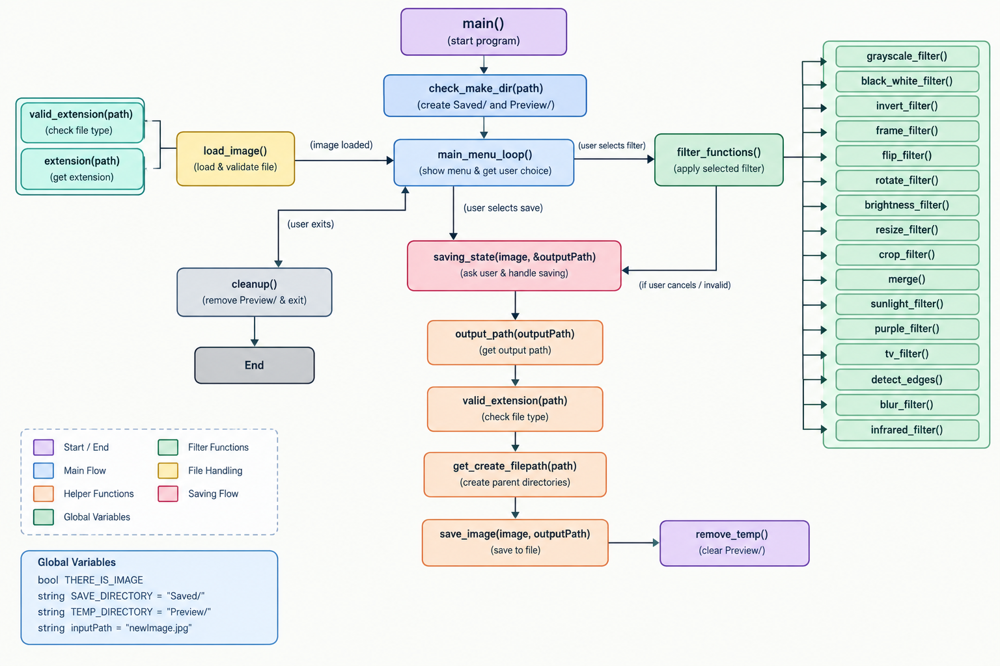

# Mozzarella
# C++ Image Processing Application

A console-based image editor developed in C++ as part of the CS213 Object-Oriented Programming course. The application allows users to load images, apply different image-processing filters, preview the results, and save the edited images.

## Features

The application includes the following features:

- **Grayscale:** Converts an image to grayscale.
- **Black and White:** Converts an image to a binary black-and-white image using a threshold.
- **Invert Colors:** Inverts the colors of an image.
- **Frame:** Adds a simple or fancy colored frame.
- **Flip:** Flips an image horizontally or vertically.
- **Rotate:** Rotates an image by 90°, 180°, or 270°.
- **Brightness:** Darkens or lightens an image.
- **Resize:** Changes the image dimensions.
- **Crop:** Crops an image using specified coordinates and dimensions.
- **Merge:** Combines two images.
- **Sunlight:** Adjusts color values to create a sunlight effect.
- **Infrared:** Applies an infrared-style color effect.
- **Purple:** Adjusts color channels to create a purple effect.
- **TV Effect:** Applies color distortions to simulate a TV effect.
- **Edge Detection:** Highlights edges in an image.
- **Blur:** Applies a blur effect.

### Image Saving

- Load images from supported file paths.
- Preview processed images in a temporary directory.
- Save edited images to the `Saved/` directory or overwrite the original file.
- Validate supported file extensions before saving.

## Technologies Used

- C++
- `Image_Class.h` — image loading, pixel manipulation, and saving
- C++ Standard Library — file handling and utility functions

## Project Structure

```text
project/
├── main.cpp
├── libraries/
│   └── Image_Class.h
├── Saved/
├── Preview/
└── README.md
```

*The structure above is an example; adjust it to match the actual repository.*

## How to Use

1. Run the application.
2. Select **Load Image** and enter the image path.
3. Choose a filter from the menu.
4. Follow the prompts to configure the filter.
5. Select **Save Image** to save your changes, or exit when finished.

## Supported Image Formats

PNG, JPG, JPEG, BMP, and TGA.

## Contributors

- Moamen Osama Zakaria
- Fady Emad Hanna
- Mahmoud Hafez Abdelfatah

## Academic Context

CS213 — Object-Oriented Programming, 2026–2027  
Assignment 1 — Image Processing Application
## Function Flow

The diagram below illustrates the main program flow and the
relationships between the image filters, saving functions,
and helper functions.


